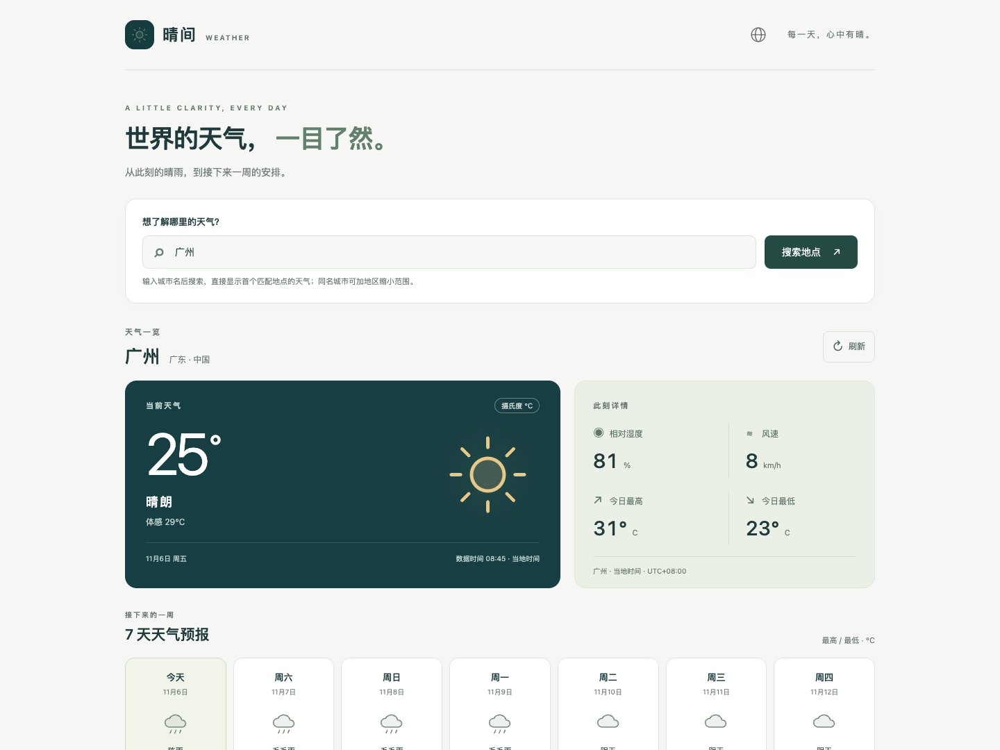
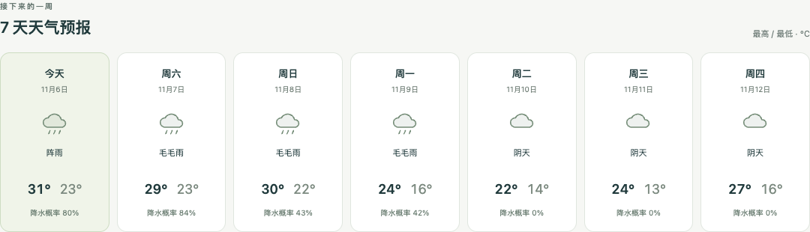

# 晴间 Weather Application

使用 React、TypeScript 和 Vite 实现的天气应用，完成地点搜索、当前天气、未来 7 天预报，以及加载、空结果和错误处理。项目面向 Frontend Take-Home Weather Application，优先保持职责清晰、状态可预测和实现范围适度。

## 页面预览

搜索地点与当前天气：



当前天气详情与 7 天预报：



## 快速运行

需要 Node.js **22.12 或更新版本**（推荐 Node.js 24 LTS）与 npm。

```bash
npm ci
npm run dev
```

打开终端显示的本地地址。首次进入默认展示香港；输入至少 2 个字符，按 Enter 或点击“搜索地点”，天气会自动更新为首个匹配地点。可点击“刷新”重新获取天气。

无需 API Key、环境变量、数据库或后端。运行时需要能访问 `api.open-meteo.com` 与 `geocoding-api.open-meteo.com`。生产页面始终请求真实接口；测试数据仅用于测试。

```bash
npm run check          # 单元/组件测试 + TypeScript 检查 + 生产构建
npm run format:check   # 检查格式
npm run build          # 输出 dist/
npm run preview        # 本地检查生产构建
```

端到端测试：

```bash
npx playwright install chromium  # 首次运行安装测试浏览器
npm run test:e2e
```

如已安装 Google Chrome，可跳过浏览器下载，在 macOS/Linux 使用 `PLAYWRIGHT_CHANNEL=chrome npm run test:e2e`；Windows PowerShell 使用 `$env:PLAYWRIGHT_CHANNEL="chrome"; npm run test:e2e`。

E2E 会自动启动独立端口 4188 的本地服务，覆盖桌面和手机视口。不要直接双击 `index.html`；开发与生产构建都需要通过 HTTP 服务访问。

## 需求对应

| 题目要求 | 实现                                                                              |
| -------- | --------------------------------------------------------------------------------- |
| 搜索地点 | 中文/英文搜索；显式提交；自动加载首个匹配地点；同名城市可用地区限定查询；键盘操作 |
| 当前天气 | 温度、体感温度、天气描述、昼夜图标、湿度、风速、数据时间                          |
| 天气预报 | 包含今天的 7 天预报：天气状况、最高/最低温、每日最高降水概率                      |
| Loading  | 搜索独立加载状态；天气加载提示；重复提交按钮禁用                                  |
| Error    | 网络失败、12 秒超时、HTTP 错误、限流、响应格式错误；保留输入并支持重试            |
| 交付     | 完整源码、依赖锁文件、README、单元/组件测试与 E2E 测试                            |

## 架构与代码组织

```text
src/
  App.tsx                       应用组合与选中地点
  api/weather.ts                HTTP、超时、错误分类、Zod 数据边界、API 参数
  hooks/useRequest.ts           异步请求生命周期和重试
  components/
    LanguageMenu.tsx            图标入口、边界定位、语言选项和键盘操作
    LocationSearch.tsx          表单、校验、自动加载地点及搜索状态
    WeatherDashboard.tsx        天气与预报展示
    WeatherIcon.tsx             本地 SVG 天气图标
    Notice.tsx                  错误提示与重试入口
  i18n/                         四种语言文案、语言 Context 与偏好持久化
  lib/format.ts                 日期、数值、WMO 天气码映射
  styles.css                    响应式样式
  test/                         测试配置和固定样例
  **/*.test.ts(x)               与实现相邻的测试
 e2e/weather.spec.ts             浏览器交互测试
```

数据流为：**输入查询 → 地点搜索 API → 首个匹配地点的坐标 → 天气 API → 校验响应 → 展示**。展示组件通过 props 接收数据，不负责网络请求。外部 JSON 以 `unknown` 进入 API 层，通过 Zod 校验后再作为可信类型返回。

## 设计决策与取舍

### React + TypeScript + Vite

应用只有一个页面，数据来自公开 API，不需要服务端渲染、路由或数据库。Vite SPA 可以保持启动和部署简单；TypeScript 提供编译期约束，Zod 补足运行时边界。构建产物是普通静态文件，可以部署到静态托管服务。

### 本地状态与一个小型请求 Hook

选中地点由 App 持有，输入和搜索词由搜索组件持有。请求状态用判别联合表达 `idle/loading/success/error`，避免多个布尔值产生矛盾状态。天气使用 `useRequest` 管理请求生命周期，搜索通过受控的 AbortController 管理显式提交和自动更新；天气数据不引入 Redux 或查询缓存库，因为目前没有跨页共享或复杂缓存需求。语言设置通过独立的小型 Context 共享。

稳定的 `useCallback` 是请求身份。切换身份或重试时，旧结果立即不再展示；effect 清理会取消请求，并用 `active` 标记阻止已经完成或不支持取消的旧请求写入状态。这样不会把香港的数据放在伦敦标题下面。React StrictMode 在开发模式可能启动并取消首个请求，属于预期生命周期验证。

### 显式搜索，直接更新天气

搜索通过按钮或 Enter 提交，而非每次输入都请求。这样无需防抖计时器，减少调用，并适合中文输入法。编辑输入即取消旧搜索；查询成功后自动加载供应商返回的首个匹配地点，不再展示候选列表。这个取舍减少一步点击，但可能选到同名城市，因此标题会保留地区说明，并提示用户可输入 `London, UK` 等限定查询来缩小范围。搜索失败不影响已选城市的天气。

### 错误与缺失值分开处理

所有请求有 12 秒超时，并在结束时清理计时器和监听器。用户触发的取消不作为错误展示。429、其他 HTTP 错误、网络失败、超时和非法 JSON/结构分别处理，向用户展示可理解的信息，不显示供应商的原始错误正文。选择手动重试，避免自动重试加重限流。

合法 `null` 测量值显示“—”，真实的 0 正常展示。未知天气代码显示“天气状况暂缺”。预报数组必须长度一致，日期必须递增；不合法数据进入错误状态，不伪造成功。供应商只返回少于 7 天时展示现有日期并明确提示。

### 日期、单位与天气语义

请求固定使用摄氏度和 km/h，设置 `timezone=auto`。ISO 日期是目的地当地的日历日期，展示时不把它误当作用户浏览器时区的时间戳；星期通过 UTC 中午的日期计算，显示数据时间直接使用接口返回的当地时间。

页面标注了数据时间和目的地 UTC 偏移（来自接口的 `utc_offset_seconds`），例如“广州 · 当地时间 · UTC+08:00”。`Asia/Shanghai` 是中国标准时间的 IANA 时区标识，并非广州的拼音，因此详情栏不再直接展示这个易混淆的原始标识；当前天气是模型估算，并非宣称来自实时实测气象站。每日天气代码代表当日综合天气，不必与当前时刻一致。降水概率字段为每日最高值。WMO 天气码映射含晴、云、雾、雨、冻雨、雪和雷暴，当前晴夜使用月亮图标。

### 范围控制

本次实现没有扩展账户、收藏、地图、定位授权、小时图表、离线模式和单位切换。仅语言偏好写入 localStorage，没有天气缓存或自动轮询；刷新页面恢复香港并保留语言，点击刷新重新请求。这样把重点放在题目核心和边界可靠性上，避免把 4–6 小时级别的题目变成大型产品。

若后续增加多个天气页、收藏和缓存，可引入 TanStack Query 管理缓存、过期和请求去重；如使用带私钥的商业供应商，应增加服务端代理，不把私钥放进前端。当前直接调用公开接口，供应商的可用性和 CORS 行为是外部依赖。

## 多语言与配色

右上角的灰色地球图标打开语言菜单，支持简体中文、繁体中文、粤语（书面粤语）和 English。界面、天气描述、日期、加载、错误、输入校验及辅助阅读标签同步切换；语言偏好保存在 localStorage，存储不可用时仍能在当前会话切换。默认简体中文，不根据浏览器语言自动切换。

语言切换不清空当前地点、不重复请求天气。地理搜索按英语或中文向供应商请求名称，粤语和繁体界面的地点名称沿用供应商中文结果；供应商不提供粤语地名翻译，已选地点的专名不做自动机器翻译。粤语为文字界面，不包含语音播报。日期用当地日历日期结合语言格式展示，HTML 的语言标记和页面标题也会更新。文案集中在 `src/i18n/messages.ts`，动态参数采用命名占位符，并用测试验证各语言占位符一致。

配色采用最初的深绿、浅绿和米白主题，保留低饱和度背景和柔和金色天气图标。语言入口使用 24px 灰色 SVG 地球图标，并保留 44px 点击区域。菜单通过 Portal 渲染到 body，在可视窗口水平及垂直居中，选项文字居中，并限制高度，在空间不足时内部滚动；窗口缩放和滚动时重新定位。支持方向键、Home/End、Esc、Tab、点击外部关闭以及选中后焦点返回图标。

## 交互与可访问性

- 表单有真实 label，支持 Tab / Enter，输入错误与提示通过 `aria-describedby` 关联。
- 搜索通过按钮或 Enter 提交，成功后自动更新天气，并将焦点转移到天气标题。
- 加载/结果使用状态提示，错误使用 `role="alert"`，图标有文本说明且不重复朗读。
- 提供跳转到天气区域的链接、可见键盘焦点和减少动画偏好支持。
- 桌面为双栏天气与七列预报；窄屏堆叠并采用两列预报，避免横向滚动。
- 无远程字体、图片或 UI 框架依赖；图标为项目内 SVG。

## 测试与验证

`npm test` 中的 **21 项测试**涵盖：

- 地点查询编码、空结果和供应商错误结构。
- 天气 API 的单位/时区/预报参数、合法缺失值、数组错位和类型错误。
- HTTP 429/503、非法 JSON、网络错误、超时和主动取消。
- 新请求完成后旧请求才返回的竞态、错误后重试、卸载取消。
- 0/负数/缺失值、日历日期、周日、昼夜图标和未知天气码。
- 搜索输入校验、键盘提交后自动选择首个地点、取消旧请求及失败重试。
- 翻译占位符一致性、英文日期和存储禁用时的语言切换。

本地验证结果：21 项单元/组件测试、8 项桌面/移动端 E2E 全部通过，TypeScript 检查、生产构建和代码格式检查通过。

`npm run test:e2e` 使用拦截的固定 API 响应，避免外部天气变化让测试不稳定；覆盖桌面/移动视口的搜索、首个同名匹配自动加载、天气展示、加载、限流、空结果、错误后重试和页面宽度。语言 E2E 验证四种语言、英文错误切换为粤语、刷新保留粤语以及切换语言不重复请求天气，并检查 320px 窄屏、390px 手机和 568×220 短窗口下的菜单居中和边界、焦点及关闭行为。固定样例在 `src/test/fixtures.ts`，不会进入生产应用。

另外，已在本地 Chrome 中使用**真实 Open-Meteo 接口**验证香港天气、London 地点搜索及伦敦 7 天预报，并验证输入广州后直接更新天气和 UTC+08:00 详情标签，检查桌面和 390px 手机视口；此次联调无页面运行错误、无手机横向溢出。这是一次实际联调记录，不保证外部服务一直可用。

## API 资料和使用范围

- [Open-Meteo 天气接口文档](https://open-meteo.com/en/docs)
- [Open-Meteo 地点搜索文档](https://open-meteo.com/en/docs/geocoding-api)
- [Open-Meteo 使用条款](https://open-meteo.com/en/terms)
- [GeoNames](https://www.geonames.org/)

页面保留天气和地理数据来源署名。该项目用于个人作业演示；Open-Meteo 免费接口面向非商业使用，商业上线前应按供应商条款评估适用方案。
